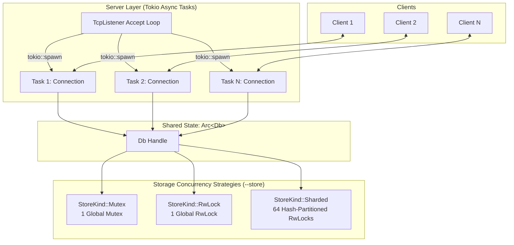
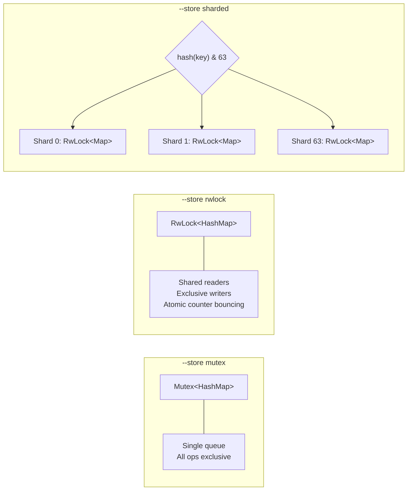
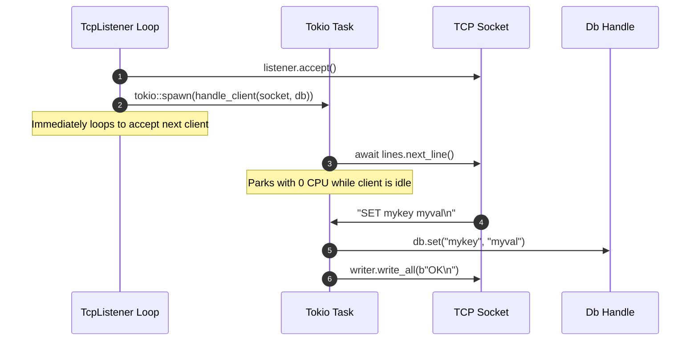
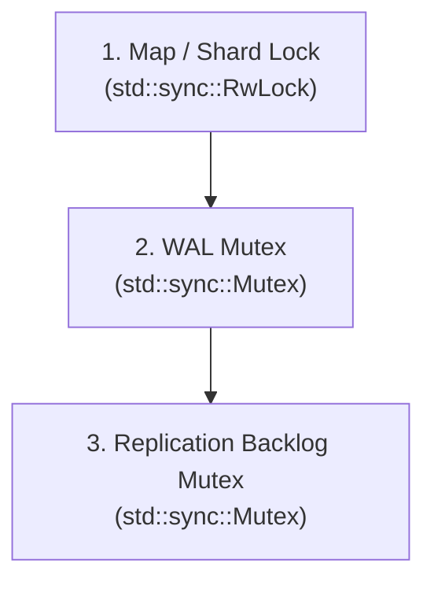

# Concurrency Models in rkv

This document provides an in-depth breakdown of the concurrency architecture in `rkv`: how requests run concurrently across threads, how in-memory state is partitioned and synchronized, why reader-writer locks can degrade multi-core throughput, and how safety invariants (such as preventing torn values and lost writes) are enforced.

For the general request lifecycle and storage engine, see [ARCHITECTURE.md](ARCHITECTURE.md). For benchmark methodology and raw numbers, see [PERFORMANCE.md](PERFORMANCE.md). For multi-node synchronization, see [REPLICATION.md](REPLICATION.md).

---

## 1. Concurrency Architecture Overview

Concurrency in `rkv` operates across two primary layers:

1. **The Network / Server Layer (Asynchronous I/O via Tokio):**
   Handles incoming network traffic across thousands of concurrent clients without thread-per-connection OS overhead.
2. **The Storage / Engine Layer (Thread Synchronization in Memory):**
   Controls concurrent access to the shared key-value dictionary across CPU cores.



---

## 2. In-Memory Storage Concurrency (`StoreKind`)

All key-value data lives in `HashMap<String, Bytes>`. How threads access this data is configured by `--store <mutex|rwlock|sharded>` (defined in [`src/db.rs`](../src/db.rs)).

### Internal Type Architecture

To avoid duplicating the write and durability paths across all three strategies, [`Db`](../src/db.rs) wraps an internal [`Inner`](../src/db.rs) enum behind an `Arc<Shared>`:

```rust
enum Inner {
    Mutex(Mutex<Map>),
    RwLock(RwLock<Map>),
    Sharded(Sharded),
}

enum MapGuard<'a> {
    Mutex(MutexGuard<'a, Map>),
    RwLock(RwLockWriteGuard<'a, Map>),
}
```

The method `inner.write_map(key)` acquires the appropriate exclusive lock and returns a `MapGuard`, allowing `set()` and `del()` logic (including WAL logging and replication backlog pushes) to be written once for all three locking strategies.



---

### Strategy A: Global Mutex (`StoreKind::Mutex`)

#### Mental Model: **A single room with a single key**
Everyone waits in a single queue outside the door. Only one thread can enter the room at a time, regardless of whether it is just reading a key or modifying it.

```text
Thread 1 (GET "user:1")  ──┐
Thread 2 (GET "user:2")  ──┼──> [ Mutex<HashMap> ] ──> Only 1 runs at a time
Thread 3 (SET "user:3")  ──┘
```

#### Mechanics:
- **Backing Structure:** `std::sync::Mutex<HashMap<String, Bytes>>`.
- **How Reads Work (`GET`):** Calls `m.lock().unwrap()`. It acquires an **exclusive lock**. Even though it only reads, all other reader and writer threads are blocked.
- **How Writes Work (`SET` / `DEL`):** Calls `write_map()` which acquires `m.lock().unwrap()`. It logs to the WAL while holding the lock, updates or removes the entry, and unlocks.
- **Trade-offs:**
  - **Pros:** Simplest implementation, zero overhead on a single core, no reader-writer starvation risks.
  - **Cons:** Under multi-core parallel traffic, threads contend on a single lock. In memory, scaling collapses from ~15M ops/s on 1 thread down to **~4–5M ops/s** on 4+ threads.

---

### Strategy B: Global Reader-Writer Lock (`StoreKind::RwLock`)

#### Mental Model: **A library reading room**
Any number of readers can sit and read simultaneously. But when someone needs to modify/renovate the room (write), all readers must exit first, and only the writer enters exclusively.

```text
Thread 1 (GET "user:1")  ──┐
                           ├──> [ Shared Read Lock ] ──> Run in parallel!
Thread 2 (GET "user:2")  ──┘
                                      │
Thread 3 (SET "user:3")  ─────────────┴──> [ Exclusive Write Lock ] ──> Waits for readers to drain
```

#### Mechanics:
- **Backing Structure:** `std::sync::RwLock<HashMap<String, Bytes>>`.
- **How Reads Work (`GET`):** Calls `m.read().unwrap()`. Multiple threads acquire shared read guards simultaneously without blocking each other.
- **How Writes Work (`SET` / `DEL`):** Calls `write_map()` which acquires `m.write().unwrap()`. It waits until all active readers release their locks, then takes exclusive access to log and update the map.
- **The Hardware Reality (Cache-Line Bouncing):**
  - In theory, an 80% read workload should scale across multiple reader threads.
  - In practice on multi-core CPUs, `std::sync::RwLock` maintains an internal atomic reader counter.
  - Every thread calling `read()` executes an atomic instruction (`fetch_add`) to bump this counter, and a `fetch_sub` on release.
  - Under the CPU cache coherence protocol (MESI), this single 64-byte cache line is continuously invalidated and bounced back and forth between L1/L2 caches of different CPU cores.
  - Because of this cache contention, `RwLock` in memory drops to **~2.9M ops/s** at 8 threads—**slower than a single `Mutex`!**

---

### Strategy C: 64-Way Hash Sharding (`StoreKind::Sharded`)

#### Mental Model: **64 separate bank teller windows**
Instead of one big counter, there are 64 separate windows. When you arrive with a key, the hash of that key determines which window you visit (`hash(key) % 64`). Clients visiting different windows never wait for each other.

```text
Key "user:1" ──> hash & 63 = Shard 12 ──> [ Shard 12: RwLock<Map> ]
Key "order:5"──> hash & 63 = Shard 45 ──> [ Shard 45: RwLock<Map> ]  (Zero contention!)
Key "item:99"──> hash & 63 = Shard 12 ──> [ Shard 12: RwLock<Map> ]  (Contends only on Shard 12)
```

#### Mechanics:
- **Backing Structure:** A boxed slice of 64 independent `RwLock<HashMap<String, Bytes>>` shards (`DEFAULT_SHARDS = 64`):
  ```rust
  struct Sharded {
      shards: Box<[RwLock<Map>]>,
      hasher: RandomState,
  }
  ```
- **Shard Partitioning:** Uses a bitwise mask because 64 is a power of two:
  ```rust
  fn shard(&self, key: &str) -> &RwLock<Map> {
      let h = self.hasher.hash_one(key) as usize;
      &self.shards[h & (self.shards.len() - 1)] // h & 63
  }
  ```
- **How Reads Work (`GET`):** Identifies the key's shard via its hash, and acquires a `read()` lock **only on that single shard**. The other 63 shards remain completely unblocked.
- **How Writes Work (`SET` / `DEL`):** Calls `write_map(key)` which acquires an exclusive `write()` lock **only on that single shard**. Writes to different shards execute simultaneously.
- **Trade-offs:**
  - **Pros:** Near-linear scaling across CPU cores. Different threads touch different cache lines, avoiding cache thrashing. Reaches **86.5M ops/s** on 16 threads (a **21.8× speedup** over Mutex).
  - **Cons:** On a single thread with no contention, it is ~25% slower because it hashes the key twice (once to pick the shard index, once inside the underlying `HashMap`).

---

### Strategy Summary Comparison

| Strategy | Backing Type | Read Lock | Write Lock | In-Memory (16 threads) | Strengths & Bottlenecks |
|---|---|---|---|:---:|---|
| **`Mutex`** | `Mutex<Map>` | Exclusive | Exclusive | 4.0M ops/s | Simple, zero overhead on single core; high thread contention. |
| **`Rwlock`** | `RwLock<Map>` | Shared | Exclusive | 4.0M ops/s *(2.9M at 8 threads)* | Allows parallel reads, but atomic reader counter bounces across CPU caches. |
| **`Sharded`** | 64 × `RwLock<Map>` | Shared per-shard | Exclusive per-shard | **86.5M ops/s** | Independent cache lines; scales linearly with CPU cores. |

---

## 3. Benchmark Comparison: In-Memory vs Over TCP

The performance difference between these models depends heavily on where the bottleneck lies:

### In-Memory Criterion Scaling (`cargo bench --bench store`)

Hammering `Db::get` and `Db::set` directly with OS threads (80% reads, 20% writes, 10k keys, 64-byte values on an Intel Core Ultra 9 275HX):

| Active Threads | Mutex (M ops/s) | RwLock (M ops/s) | Sharded (M ops/s) | Sharded vs Mutex Speedup |
|:--------------:|:---------------:|:----------------:|:-----------------:|:-----------------------:|
| **1**          | 15.3            | 15.1             | 11.4              | 0.7× *(hash overhead)*  |
| **4**          | 5.0             | 4.2              | 26.8              | **5.3×**                |
| **8**          | 5.0             | 2.9              | 53.3              | **10.7×**               |
| **16**         | 4.0             | 4.0              | **86.5**          | **21.8×**               |
| **24**         | 4.9             | 3.5              | 67.8              | **13.9×** *(E-cores)*   |

> **Why Sharded is slower on 1 thread:** It hashes the key twice (once to pick the shard index, and once inside the underlying `HashMap`). With no lock contention to overcome, the extra hash calculation costs ~25%.
>
> **Why RwLock degrades at 8 threads:** Cache-line bouncing on the atomic reader counter stalls CPU execution units.

### Over TCP Network Reality (`rkv-bench --compare stores`)

50 concurrent TCP clients × 20,000 ops over loopback:

| Store Strategy | Throughput (ops/sec) | Latency p50 | Latency p99 | CPU / op |
|:--------------:|:--------------------:|:-----------:|:-----------:|:--------:|
| **mutex**      | 137,238              | 328 µs      | 853 µs      | 31.9 µs  |
| **rwlock**     | 132,219              | 336 µs      | 923 µs      | 34.4 µs  |
| **sharded**    | 132,935              | 335 µs      | 903 µs      | 35.4 µs  |

**Why all three perform identically over TCP:**
A typical request over TCP takes ~32 microseconds of CPU time:
- ~22 µs is spent in OS socket system calls (`read`, `write`, `epoll`/`IOCP`).
- ~9.5 µs is spent in Tokio task scheduling, buffer framing, and string parsing.
- Accessing the in-memory map under a lock takes **less than 50 nanoseconds**.

Because lock acquisition represents less than 0.2% of the total request lifecycle, the network stack completely masks lock contention. Sharding becomes crucial when running in-process, with connection pipelining, or with kernel-bypass networking (e.g., `io_uring`).

---

## 4. Server & Connection Concurrency (Tokio)

The server concurrency architecture in [`src/server.rs`](../src/server.rs) is built around Tokio's asynchronous runtime:



### Key Principles

1. **Task-per-Connection:**
   - Every connection gets its own Tokio task.
   - Tasks are lightweight user-space green threads (~9.7 KB memory footprint per connection).
   - Idle connections park their tasks asynchronously; 200 idle connections consume 0 ms of CPU.

2. **Why Standard `std::sync` Locks Instead of `tokio::sync`?**
   - Critical sections never perform asynchronous operations and **never cross an `.await` boundary**.
   - A lock is held for tens of nanoseconds (in-memory lookup) or for a synchronous `write()` syscall to the OS page cache.
   - Using asynchronous mutexes (`tokio::sync::Mutex`) would introduce task queue allocation overhead, context switches, and boxing without any concurrency advantage.

3. **Background Asynchronous & OS Workers:**
   - **WAL Sync Worker (`--fsync every-sec`):** Runs on a dedicated OS thread to prevent blocking Tokio worker threads during disk `fsync()` system calls.
   - **Replication Tasks:** Each connected replica spawns a streaming task on the leader that observes updates via a `tokio::sync::watch` channel and streams records from the replication backlog.

---

## 5. Lock Ordering & Deadlock Prevention

`rkv` combines in-memory maps, an append-only Write-Ahead Log (WAL), and a replication backlog. To guarantee total freedom from deadlocks, all operations follow a strict, non-negotiable **Lock Acquisition Hierarchy**:



### Deterministic Rules:
1. **Never acquire locks in reverse:** No thread or task ever attempts to acquire a map/shard lock while holding the WAL or Backlog mutex.
2. **Log-Then-Apply Ordering:**
   - A writer locks the target shard.
   - The record is appended to the WAL (and disk-flushed if `--fsync always`).
   - The record is appended to the replication backlog.
   - The in-memory `HashMap` is mutated.
   - The shard lock is released.
3. **Consistency Invariant:**
   Because the shard lock is held continuously across WAL logging and in-memory mutation:
   - Two concurrent writes to the same key (`SET k v1` and `SET k v2`) reach the WAL in the **exact same order** they reach memory.
   - A crash replay will never produce a state divergent from what clients observed.

---

## 6. Concurrency Safety Guarantees & Testing

The concurrency test suite in [`tests/concurrency.rs`](../tests/concurrency.rs) runs against **all three storage kinds** to verify safety invariants under maximum thread contention:

| Safety Invariant | What It Means | Verification Test |
|---|---|---|
| **No Lost Writes** | Every acknowledged write must be visible to subsequent reads. | `no_lost_writes_across_threads`: 24 threads concurrently issue 5,000 writes across disjoint keys. Zero lost writes. |
| **No Torn Values** | A read never returns a half-written value from another thread. | `no_torn_values_on_contended_keys`: Concurrent threads overwrite 8 hot keys with patterned buffers while readers verify integrity. |
| **Read-Your-Writes** | A connection always sees its own prior writes immediately. | `server_100_clients_read_your_writes`: 100 parallel TCP clients verify monotonic write visibility. |
| **Deadlock Freedom** | Systems never freeze or cycle under contention. | All tests run under a strict 60-second timeout; any deadlock fails the test. |
| **Isolation from Abrupt Drops** | Malformed inputs or dropped sockets do not corrupt peer tasks. | `abrupt_disconnects_do_not_affect_other_clients`: 50 clients drop mid-frame; surviving connections are unaffected. |

---

## 7. Commands to Run Benchmarks & Tests

```sh
# Run all concurrency integration tests
cargo test --release --test concurrency

# Benchmark lock scaling in memory with Criterion
cargo bench --bench store

# Compare all 3 store strategies over TCP
cargo build --release
target/release/rkv-bench --compare stores
```
